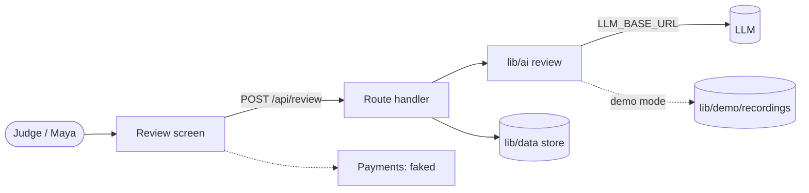

# ARCHITECTURE.md template

Copy the block below into `hack/ARCHITECTURE.md`. Write prose in `doc_language`; keep code identifiers, paths, and env names in English. `hack-architecture` fills every section except AI pipeline, API, and Data, which `hack-backend` fills.

Keep exactly one `Status:` line, as every planning doc does (git-flow.md §Planning docs and gate locks). Move it from `draft` to `ready (contracts F-NN merged <sha>)`, and never to `locked`, because only G1 and G2 lock. Replace every `<…>` placeholder.

````markdown
# Architecture: <project>

Status: draft
Pitch: hack/PITCH.md (D-NN) · Spec: hack/SPEC.md · Contracts card: F-NN (merged <sha>)

## Stack

| Layer | Choice | Golden or D-NN |
|---|---|---|
| App | Next.js 16 App Router, TypeScript | golden |
| UI | Tailwind v4, shadcn/ui, motion | golden |
| LLM | AI SDK 7 via OpenAI-compatible `LLM_*`; model <name> | golden |
| Data | rung <0 none / 1 SQLite / 2 Supabase> | D-NN |
| Deploy | <Vercel / Fly.io> | D-NN |
| Other | <sponsor API, sidecar, …> | D-NN |

## Diagram



## Directory and ownership

| Glob | Lane | Notes |
|---|---|---|
| `app/(screens)/**`, `components/<feature>/**` | fe | one folder per feature |
| `app/api/**`, `lib/data/**` | be | |
| `lib/ai/**`, `lib/demo/**` | ai | |
| `lib/design/**`, `components/ui/**` (add-only) | design | |
| `e2e/**`, `scripts/**`, `vercel.json`, `fly.toml` | infra | |

Collision-prone files and their rule: <file → split into feature components / owner-only / shared-zone branch>

## Shared zone

`lib/contracts/**`, `package.json`, the lockfile, `app/layout.tsx`, global CSS and tokens, `.env.example`, `next.config.ts`, `proxy.ts`, <others>. Change only through a small dedicated branch merged first.

## Contracts

| Schema | File | Used by |
|---|---|---|
| ReviewRequest, ReviewResult | `lib/contracts/review.ts` | /api/review, ReviewPanel |

| Route | Method | Request | Response | Streams | Beat |
|---|---|---|---|---|---|
| /api/review | POST | ReviewRequest | ReviewResult | yes | B2 |

Fixtures: `lib/contracts/fixtures/` around persona <name, role>.

## Fake vs real

| Capability | Status | README disclosure |
|---|---|---|
| Contract review (core AI) | real | — |
| Demo mode | real outputs, replayed | "Demo mode replays recorded real model outputs; live mode calls the model." |
| <auth / payments / sync> | <faked / seeded / cut> | "<what is mocked>" |

## AI pipeline

Owned by hack-backend: pipelines, prompts, structured output, latency budget per beat, timeouts and fallback, cost guard, demo recordings, eval.

## API

Owned by hack-backend: route handlers and server actions, validation, error shape.

## Data

Owned by hack-backend: rung, entities, seed (`lib/demo/seed.ts`), store module.

## Environment

| Name | Where | Purpose |
|---|---|---|
| LLM_BASE_URL, LLM_API_KEY, LLM_MODEL | server | OpenAI-compatible model; never `NEXT_PUBLIC_` |
| DEMO_MODE, DEMO_RECORD | server | replay or record AI responses |
| LLM_STRUCTURED_OUTPUTS, LLM_SESSION_BUDGET | server | optional: provider JSON Schema mode, live-call cap per client |
| <DATABASE_PATH / NEXT_PUBLIC_SUPABASE_URL / …> | <server / client> | <purpose> |

## Deploy

Target <Vercel / Fly.io> (D-NN) · long routes `maxDuration` <s> · volume <none / data → /data> · owned by hack-deploy.

## Spikes

| Question | Result | Evidence | Decision |
|---|---|---|---|
| <Does model X find the payment clause in a real contract?> | <yes, 4/5> | <first chunk 1.1 s, total 6 s> | <D-NN or —> |
````
