<h1 align="center">PaperTrail</h1>

<p align="center"><b>Start from the papers you trust. Find the ones you missed, with receipts.</b></p>

<p align="center">
  <a href="#awards">
    <picture>
      <source media="(prefers-color-scheme: dark)" srcset="docs/media/award-dark.svg">
      <source media="(prefers-color-scheme: light)" srcset="docs/media/award-light.svg">
      
    </picture>
  </a>
</p>

<p align="center">
  <a href="#awards"></a>
</p>

<p align="center">
  
  
  
  
  
  
  
</p>

<p align="center">
  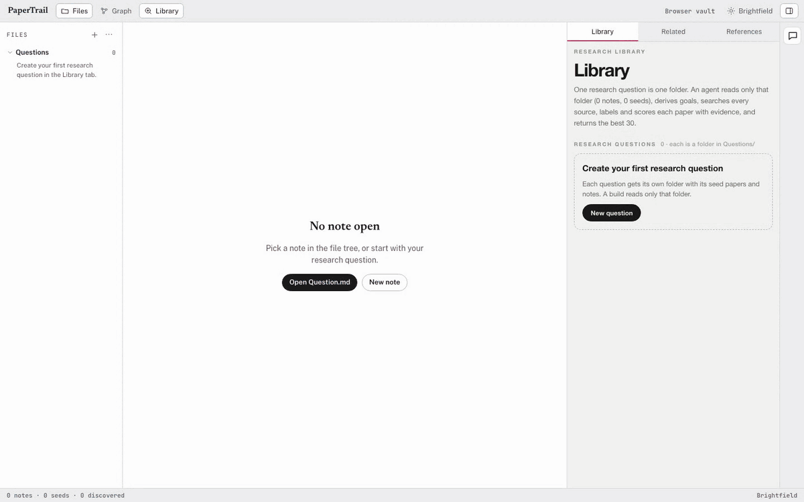
</p>
<p align="center"><sub>Real app, demo mode (replay of a recorded real run, sped up 2x).</sub></p>

Type a research question, add the papers you already trust, and PaperTrail builds a graded library of new papers, with the evidence behind every score. Winner of the Healthcare & Life Sciences "Research Paper Discovery" track at the Nebius & NVIDIA Hackathon (18 October 2026).

## Quick start

```bash
git clone https://github.com/Joevonlong/PaperTrail.git && cd PaperTrail
corepack enable pnpm
pnpm install --config.strict-dep-builds=false && pnpm build
PORT=3030 pnpm start
# open http://localhost:3030/?demo=1  (recorded real run; no keys, no network)
```

Full setup, API keys and dev mode: see [Setup](#setup).

## Features

### 1. Multi-source paper search

<p align="center">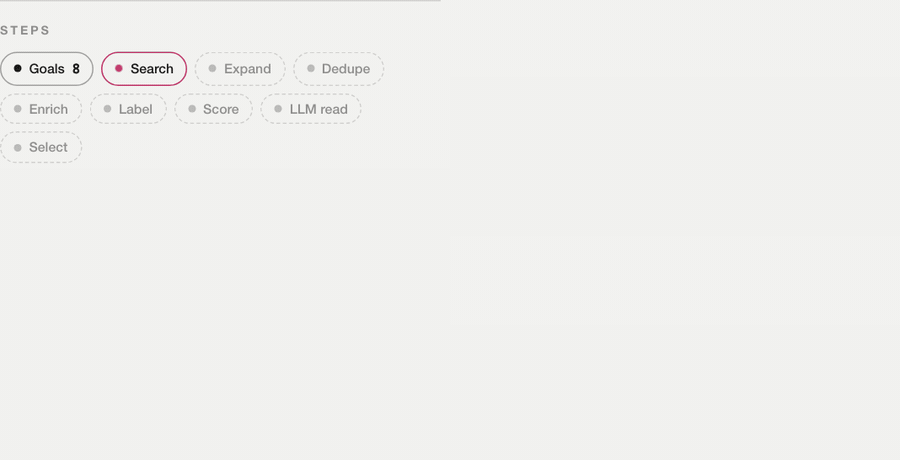</p>

| Source | What it adds |
|---|---|
| **OpenAlex** | Keyword and subtopic search; references and citing papers of your seeds; citation, venue and author data |
| **PubMed** | Biomedical search; "similar articles" of your seeds; publication types |
| **arXiv** | Preprints |
| **Tavily** | Web search on science sites (bioRxiv, medRxiv, PubMed Central, journal sites) |
| **Europe PMC · Crossref** | Fallback when OpenAlex is unavailable: reference lists and cited-by counts |

An agent first turns your question into goals and subtopic queries. Recorded run: 81 source calls, 599 papers scored in 84.9 s.

### 2. Ranking and scoring with evidence

<p align="center">
  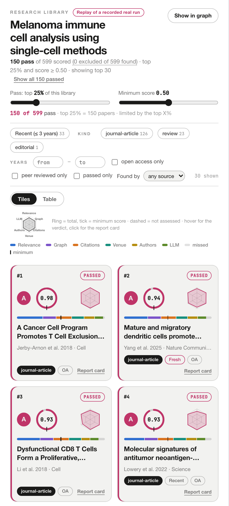
  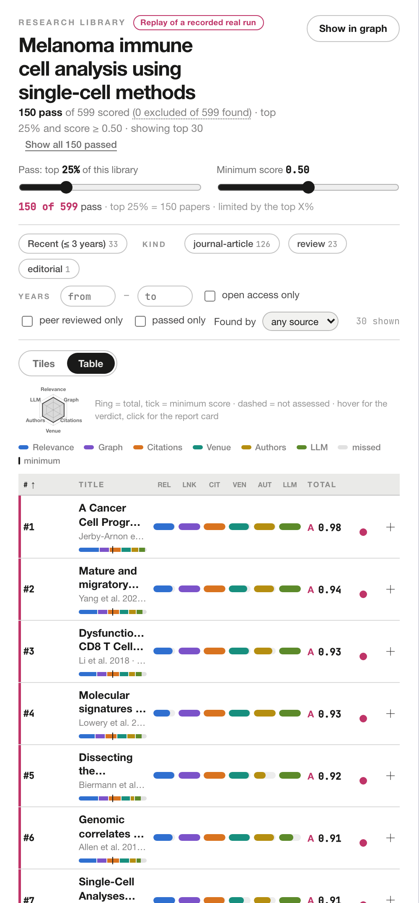
</p>
<p align="center">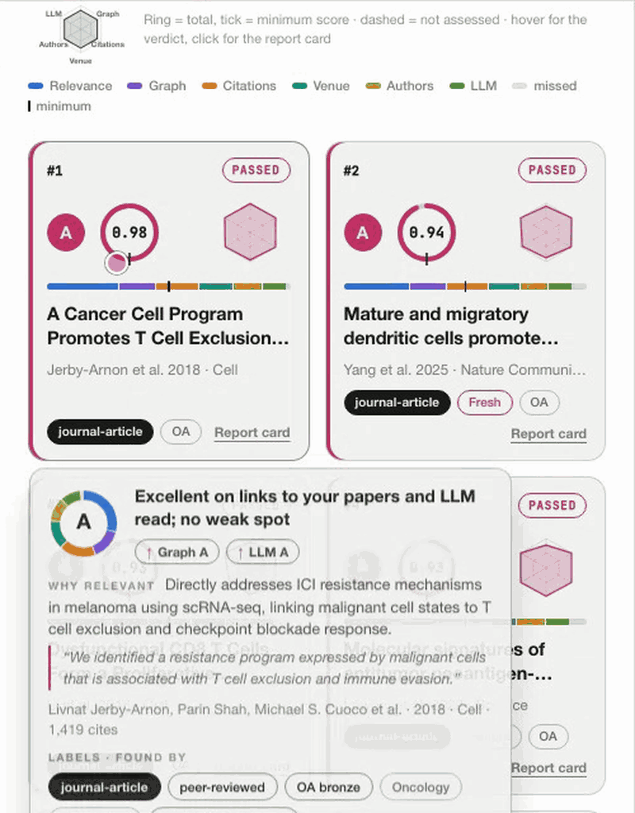</p>

Each paper gets a total (0–1) and a grade (A ≥ 0.85, B ≥ 0.70, C ≥ 0.55, D ≥ 0.40, else E) from six components:

| Component | Weight | How it is scored |
|---|---|---|
| **Relevance** | 0.30 | Embedding similarity (Qwen3) of title + abstract to your question and subtopics |
| **Citations** | 0.18 | OpenAlex citation percentile for field and year (fallback: cited-by percentile within the library) |
| **Graph** | 0.15 | Citation links to your seed papers: 0 links = 0, 1 = 0.5, 2+ = 1 |
| **Venue** | 0.15 | Journal h-index percentile, core source, journal or conference, indexed (preprint servers: fixed 0.2) |
| **Authors** | 0.12 | Highest h-index of first / last author, plus a known institution |
| **LLM read** | 0.10 | Nemotron reads the abstract and rates relevance and quality; its quote must appear word for word |

A component without data is shown as "not assessed" and its weight moves to the others. Recorded run: 37 of 40 quotes verified.

### 3. Filters and pass rule

<p align="center">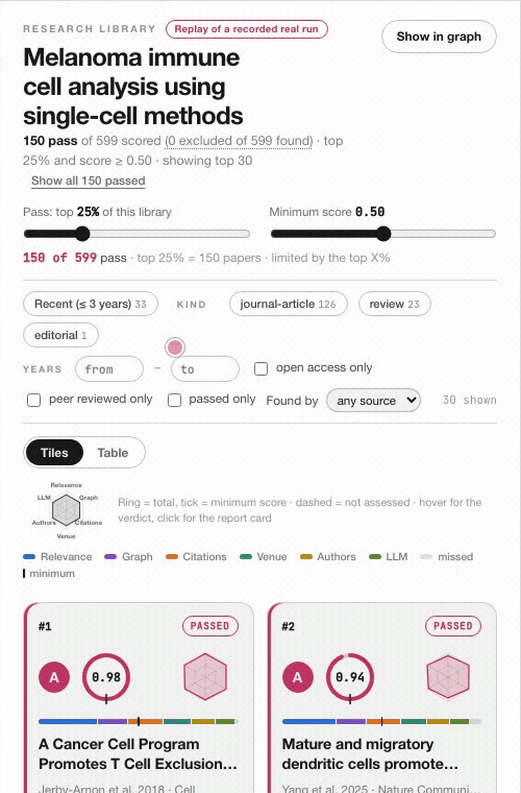</p>

- **Pass rule:** top X% of the library (default 25%) and a minimum score (default 0.50). Recorded run: 150 of 599 pass.
- **Filters:** recent papers, article kind (journal article, review, preprint…), years, open access, peer reviewed, source.
- Re-scores instantly in the browser, no rebuild.

### 4. Graph view

<p align="center">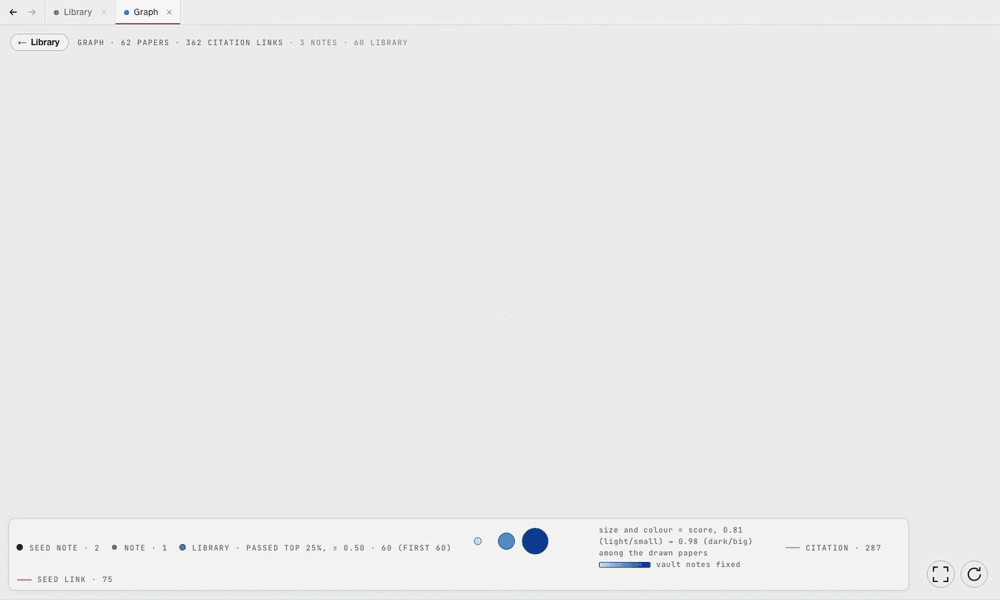</p>

| In the graph | Meaning |
|---|---|
| **Black node** | A seed paper in your question folder (dark grey: your other notes) |
| **Blue node** | A library paper that passed: **bigger and darker = higher score** |
| **Grey line** | One paper cites the other |
| **Red line** | Link to a seed paper |

Hover a node to highlight its links. The demo graph shows 60 papers and 287 citation links.

### 5. Chat that proposes, you apply

<p align="center">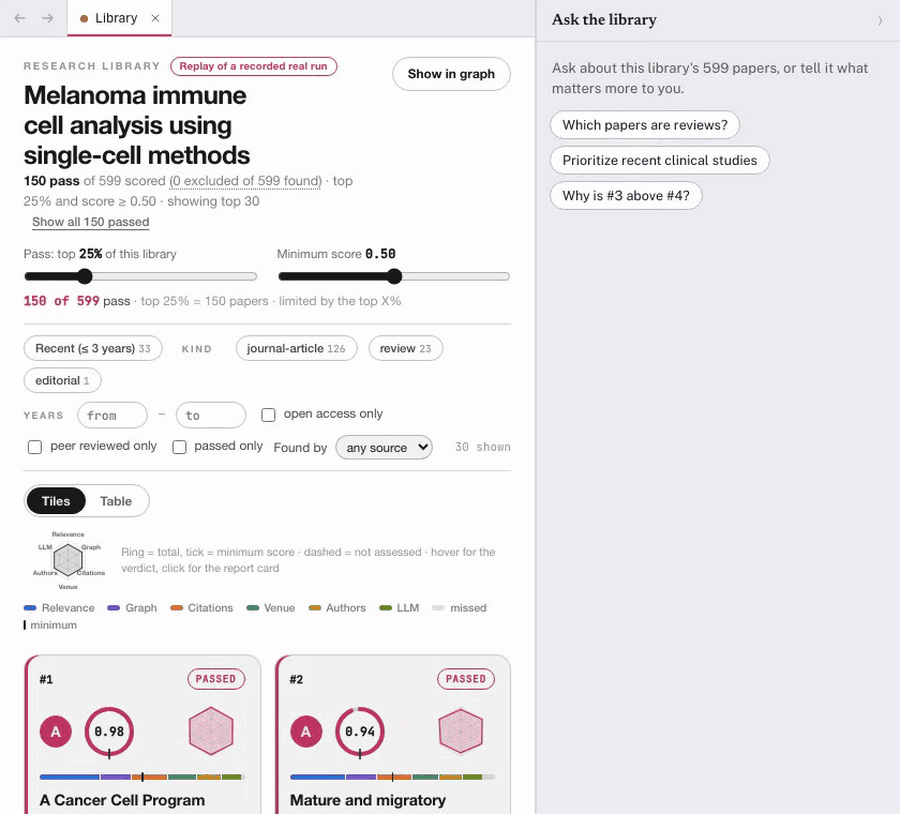</p>

- Ask about the library ("Which papers are reviews?") or say what matters ("Prioritize recent clinical studies and ignore preprints").
- The chat proposes weight and filter changes; nothing changes until you click **Apply**. Rank arrows show every move (recorded run: 8 papers enter the top 10).

### More

<table>
<tr>
<td width="50%" valign="top"><b>Question folders and seeds.</b> One question = one folder with its notes and seed papers. Paste DOIs, PMIDs, arXiv or OpenAlex ids, or upload .bib, .ris, CSL JSON or PDF.<br><br>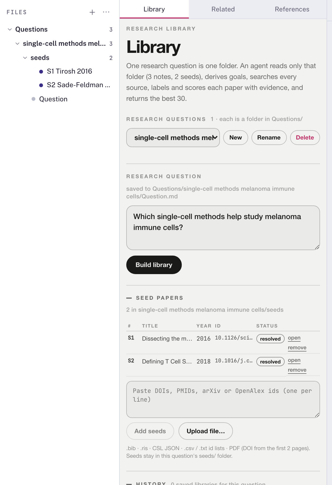</td>
<td width="50%" valign="top"><b>Vault and export.</b> Add a paper as a Markdown note (front matter, verified quote, citation relations) in the question's <code>notes/</code> folder. Export BibTeX, CSL JSON or a Markdown .zip.<br><br>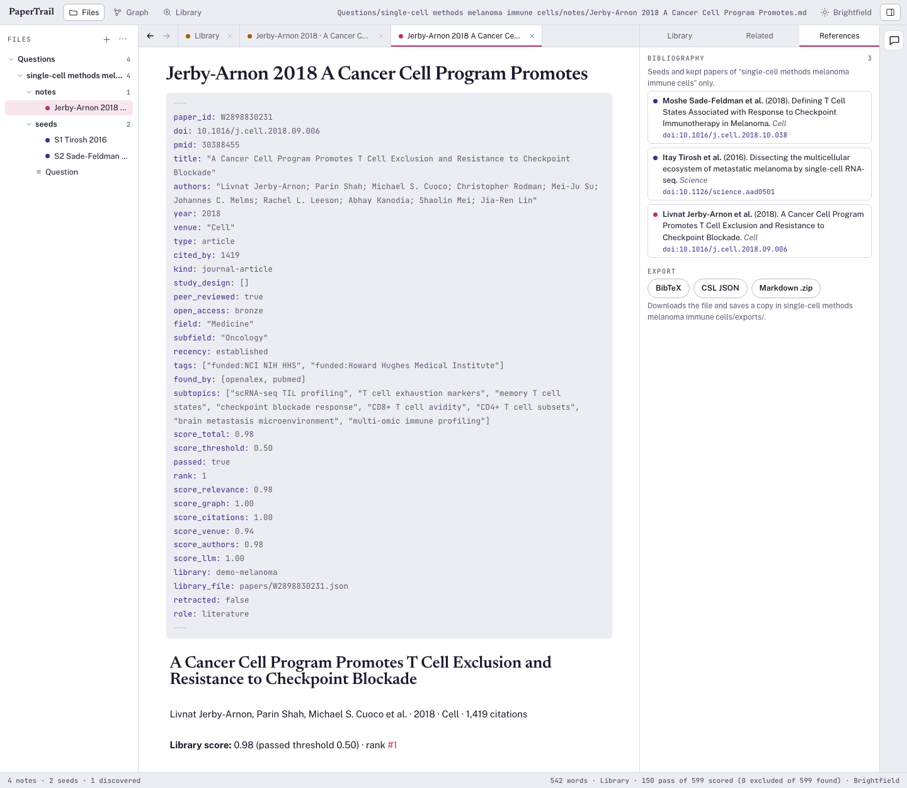</td>
</tr>
</table>

## How it works

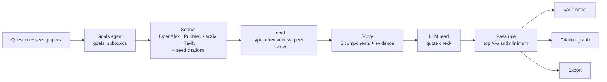

Papers already in your vault and retracted papers are excluded. Every source and model call is traced under `logs/runs/<libraryId>/`.

## Results

- **Recorded run** (melanoma single-cell question, 5 seeds): 84.9 s, 81 source calls, 599 papers scored, 150 passed, 37 of 40 LLM quotes verified. PubMed with the same question returns 15 results.
- **Hold-out test** on two real reviews (5 references kept as seeds, the rest hidden): 6 to 10 hidden references in the top 30, against 0 to 4 for a PubMed title search and 0 to 1 for OpenAlex search. Details: [eval/RESULTS_LIBRARY.md](eval/RESULTS_LIBRARY.md).
- **Cost:** about 214k–223k tokens per build; about 16k per chat turn.

Only measured numbers are listed. `?demo=1` replays a real run; the production build uses no mock data.

## Under the hood

| Part | Choice |
|---|---|
| App | Vue 3 + Pinia + CodeMirror 6 + d3 (Zettlr-style workspace) · Hono on Node 22 · SQLite |
| Embeddings | `Qwen/Qwen3-Embedding-8B` (Nebius Token Factory) |
| Judge (LLM read) | `nvidia/Nemotron-3_5-Lightning` |
| Planner and chat | `nvidia/nemotron-3-super-120b-a12b` |

Without keys, AI steps are skipped or fall back (for example, keyword overlap instead of embeddings), and the stage says so. Specs: [docs/PRODUCT_PLAN.md](docs/PRODUCT_PLAN.md), [docs/LIBRARY_SPEC.md](docs/LIBRARY_SPEC.md).

## Setup

Requires Node 22+, pnpm (`corepack enable pnpm`) and git.

```bash
git clone https://github.com/Joevonlong/PaperTrail.git && cd PaperTrail
pnpm install --config.strict-dep-builds=false   # flag: pnpm otherwise stops on esbuild's ignored build script
cp .env.example .env.local                      # optional keys, see below

pnpm dev                             # dev: http://localhost:5173 (API on :3001)
pnpm build && PORT=3030 pnpm start   # production: http://localhost:3030
scripts/docker-local.sh              # Docker (needs .env.local): http://localhost:3040
```

Add `?demo=1` to any URL to replay a recorded run (no keys, no network).

**Keys** (`.env.local`, git-ignored; restart after editing). Without them, AI steps are skipped or fall back.

| Variable | Enables |
|---|---|
| `TOKEN_FACTORY_API_KEY` | embeddings, planner, LLM read, chat |
| `TAVILY_API_KEY` | web search |
| `OPENALEX_API_KEY`, `OPENALEX_MAILTO` | own OpenAlex budget (without it, a shared per-IP daily budget; once spent, Authors, Venue and Citations go unscored until midnight UTC) |
| `SERPAPI_KEY` | Google Scholar |

Check: `curl localhost:3001/api/health` shows which keys are loaded; `pnpm exec tsx scripts/smoke-models.ts` tests them.

**First library:** type a question, add papers you trust in the **Library** tab (DOI, PMID, arXiv/OpenAlex id, or .bib/.ris/CSV/PDF; the Graph score needs them), then **Build library**.

**Files** (git-ignored): `workspace/` holds questions, notes and libraries; `data/` holds the API cache and SQLite; `logs/runs/<id>/` holds per-run traces (check them first when a score is missing).

`pnpm gate` = typecheck + tests + build. Nebius Serverless deploy: `scripts/deploy.sh` (ready, not run).

## Awards

| Award | Event | Track | Date |
|---|---|---|---|
| 🏆 **Hackathon winner** | Nebius & NVIDIA Hackathon | Healthcare & Life Sciences · Research Paper Discovery | 2026-10-18 |

## Authors

<table>
  <tr>
    <td align="center"><a href="https://github.com/Joevonlong"><br><sub><b>@Joevonlong</b></sub></a></td>
    <td align="center"><a href="https://github.com/xingran815"><br><sub><b>@xingran815</b></sub></a></td>
    <td align="center"><a href="https://github.com/Lumberj3ck"><br><sub><b>@Lumberj3ck</b></sub></a></td>
  </tr>
</table>

## License

GPL-3.0-or-later (see [LICENSE](LICENSE)).
