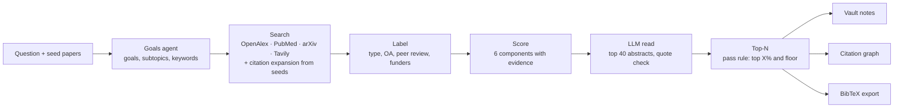

<h1 align="center">PaperTrail</h1>

<p align="center"><b>Start from the papers you trust. Find the ones you missed, with receipts.</b></p>

<p align="center">
  
  
  
  
  
  
  
</p>

<p align="center">
  
</p>

<p align="center"><sub>Real app, demo mode: the replay of a recorded real run on the melanoma question (599 papers scored, top 150 kept). Sped up 2x.</sub></p>

For researchers who already have a handful of papers they trust: type your question, add those papers, and PaperTrail builds a library of new papers from OpenAlex, PubMed, arXiv and Tavily. Every paper gets a grade and a report card where each number shows its evidence. Steer the ranking in chat, keep the best papers as Markdown notes linked to your seeds, see them in a citation graph and export BibTeX. Built for the Nebius Healthcare / Life Sciences "Research Paper Discovery" track.

## Quick start

```bash
pnpm install && pnpm build
PORT=3030 pnpm start
# open http://localhost:3030/?demo=1  (replays a recorded real run; no keys, no network)
```

## Features

### 1. Multi-source paper search

**One question searches four sources and follows the citations of your seed papers.**

<p align="center"></p>

- A goals agent reads the question's notes and writes 5 goals and 8 subtopics (recorded run, 7.4 s), each goal with a verbatim quote from your notes.
- Search runs on OpenAlex, PubMed, arXiv and Tavily, then expands from the seeds through references, citing papers and PubMed similar articles: 81 source calls in the recorded run (OpenAlex 36, PubMed 19, arXiv 13, Tavily 13), 599 papers scored in 84.9 s.
- When OpenAlex has no data, Europe PMC fills in references (227 citation links added in a build with OpenAlex switched off) and Europe PMC / Crossref supply cited-by counts.

### 2. Ranking and scoring with evidence

**Every grade comes with a report card: six components, each with its source.**

<p align="center">
  
  
</p>
<p align="center"></p>

- Six components: relevance, graph links, citations, venue, authors and the language-model read. The model read has the lowest weight by design.
- The model reads 40 abstracts per build; 37 of 40 quotes (92.5%) in the recorded run are verbatim substrings of the abstract (38 of 40 across live runs).
- Top paper in the recorded run: "A Cancer Cell Program Promotes T Cell Exclusion and Resistance to Checkpoint Blockade" (Cell, 2018), total 0.98, grade A.

### 3. Filters and pass rule

**Decide what counts as a hit, and narrow the list without rebuilding.**

<p align="center"></p>

- A paper passes if it is in the top X% of its library (default 25%) and above a floor (default 0.50): 150 of 599 passed in the recorded run.
- Chips for recent papers and article kinds, with counts on the replay (Recent, 3 years or less: 33; journal-article: 126; review: 23), plus year range, open access, peer reviewed and source filters.
- Filters and sliders re-score in the browser; no new build is needed.

### 4. Graph view

**See how the new papers cite each other and your seeds.**

<p align="center"></p>

- The demo graph draws 60 papers and 287 citation links; a real library's graph has 1,296 edges, 1,112 of them paper to paper.
- Node size and colour follow the score on a blue ramp; links to your seed papers are drawn in red.
- Hover a node to light up its citation links; papers you add to the vault join the graph.

### 5. Chat that proposes, you apply

**Ask about the library or say what matters; nothing changes until you click Apply.**

<p align="center"></p>

- "Prioritize recent clinical studies and ignore preprints" returns a proposal: relevance weight 0.30 to 0.40, keep articles and reviews from 2023 on (the same proposal in 5 of 5 calls).
- Applied to the 150 held papers, 8 papers enter the top 10 and 8 leave; rank arrows show every move. Applied changes are logged.
- A chat turn is about 15,900 tokens on `nvidia/nemotron-3-super-120b-a12b`.

### More

<table>
<tr>
<td width="50%" valign="top"><b>Question folders and seeds.</b> One research question is one folder with its notes and seed papers. Paste DOIs, PMIDs, arXiv or OpenAlex ids, or upload .bib, .ris, CSL JSON or PDF.<br><br></td>
<td width="50%" valign="top"><b>Vault and BibTeX export.</b> Add to vault writes a Markdown literature note with front matter, the verified quote and its citation relations into the question's <code>notes/</code> folder; the paper joins the graph. Export the question's references as BibTeX, CSL JSON or a Markdown .zip.<br><br></td>
</tr>
</table>

## How it works



Papers already in the vault and retracted papers are excluded. Every paper is saved as one JSON file under `data/library/<libraryId>/papers/`, and every source and model call is traced under `logs/runs/<libraryId>/`.

| Feature | What you get | Measured |
|---|---|---|
| Multi-source search | OpenAlex, PubMed, arXiv, Tavily, seed citation expansion | 81 source calls, 599 papers scored, 84.9 s (recorded run) |
| Evidence-backed score | 6 components, grade, report card | 37 of 40 quotes verified (recorded run) |
| Filters and pass rule | Top X% plus floor, chips, years, OA, peer reviewed | 150 of 599 passed at 25% / 0.50 |
| Citation graph | Score-ramped nodes, citation edges, seed links | 60 papers, 287 links (demo); 1,296 edges (real library) |
| Chat | Proposal diff, Apply, re-rank with arrows | 8 in, 8 out of the top 10 |
| Fallbacks | Europe PMC references, Europe PMC / Crossref cited-by, OpenAlex entity cache | 227 links added without OpenAlex |
| Vault and export | Markdown notes with front matter and citation relations; BibTeX, CSL JSON, .zip | not measured as a count |

## Measured results

Only measured numbers are listed, each with its source. The final recorded run is the `?demo=1` recording (`server/demo/recordings/library-melanoma.json`, recorded 2026-10-18 14:01 UTC from run `lib_20261018135951_a27857`).

**Live Library runs** (real backend, melanoma single-cell example, 5 seed papers; local):

- A build takes **94 to 102 s**, makes **74 to 107 source calls**, and scores **599 papers**.
- The language model reads **40 abstracts**; **38 of 40 quotes (95%)** are verbatim substrings of the abstract. The earlier seed pipeline verified 32 of 35 (91%).
- **Final recorded run** (the `?demo=1` replay): **84.9 s**, 82 source calls logged (81 ran; Google Scholar was skipped because no SerpAPI key is set), **599 papers scored**, 40 of 40 abstracts read, **37 of 40 quotes verified** (92.5%). 150 papers passed (top 25%, floor 0.50), 5 were excluded. The goals agent wrote 5 goals and 8 subtopics. The replay keeps the top 150 and plays back in 6.2 s.
- **Question as typed:** PubMed returns 15 results for "Which single-cell methods help study melanoma immune cells?" (NCBI esearch, count only, 2026-10-18 15:11 UTC).
- **Chat step on the recording:** "Prioritize recent clinical studies" raises the relevance weight from 0.30 to 0.40 and keeps articles and reviews from 2023 on. Applied to the 150 held papers with the browser re-score, 8 papers enter the top 10 and 8 leave (the same proposal came back in 5 of 5 calls).
- **Cost per build:** tokens measured, price not measured. Eight other builds of the same example used 213,682 to 223,076 tokens each (embeddings 180,304 to 186,217; judge 29,086 to 32,871; planner 4,292 to 5,825). The recorded run's own trace was not kept, and no Token Factory price is in the repo docs.

**Citation graph and resilience:**

- **Citation graph.** The demo graph shows **60 papers and 287 citation links** (measured in the browser on main `ba70395`). A real library's `graph.json` has **1,296 edges**, 1,112 of them paper to paper (`lib_20261018141959_87bff3`, recomputed from its papers).
- **Europe PMC fallback.** When OpenAlex has no references, Europe PMC fills in: it added **227 citation links** in a caffeine build with OpenAlex switched off, and the reference step took 9.1 s (`lib_20261018144844_4cda2c`, figures from the team's run notes; the run files are not in this checkout). When the OpenAlex budget is spent, cited-by counts come from Europe PMC and Crossref and are scored as a year-normalised percentile within the library (CR-14; not yet measured on a full build).
- **OpenAlex entity cache.** The cache holds 12,416 distinct entities (8,186 works, 3,766 authors, 464 sources) and 14,836 DOI and PMID aliases; filling it from the older URL cache processed 41,479 entity records from 1,013 cached responses (counts taken 2026-10-18 15:14 UTC).

**Hold-out test on two real reviews** (hide all but 5 references as seeds, count hidden references found; ground truth is one review's reference list, so every number is a lower bound). Details: [docs/RANKING_AND_STORAGE.md](docs/RANKING_AND_STORAGE.md) section 1 and [eval/RESULTS_LIBRARY.md](eval/RESULTS_LIBRARY.md).

- **Recall (earlier seed pipeline).** The union of the citation routes reaches **16% and 42%** of the hidden references. PubMed keyword search reaches 2% and 0%; OpenAlex search reaches 1% and 6%.
- **Ranking (earlier seed pipeline).** Ranking by seed links puts **40% and 35%** relevant papers in the top 20, against a base rate of 5.2% and 4.5%. Citation count alone scores 0% and 25%.
- **Full Library score** (7 runs on two immunology reviews): the Library put 6 to 10 hidden references in its top 30 (precision@30 0.20 to 0.33) where a PubMed title search found 0 to 4 and an OpenAlex search 0 to 1; the review itself, not in the vault, ranked in the top 4 every run. 7 to 14 of each top 30 were published after the review.

## What is real

The production build uses no mock or fixture data; a failure shows an error with Retry. `?demo=1` replays a recording of a real run so the demo works without Wi-Fi, and the replay is labelled "Replay of a recorded real run". `?mock=1` exists only in dev builds. Not used: Google Scholar (no API, and we do not scrape it) and a reranker model (Token Factory has none; relevance is embedding similarity to the question and subtopics). The language model reads abstracts only. Not built: PDF and OCR ingestion beyond DOI extraction, Postgres and LanceDB, vault sync. All README media were captured from the real app in demo mode.

## Architecture

```
Browser: Vue 3 + Pinia + CodeMirror 6 + d3; notes vault in IndexedDB; chat history in the browser
   | HTTP + SSE
One local server (Node 22, Hono): http://localhost:3030 (pnpm) or :3040 (Docker)
   server/library    goals agent, search (OpenAlex, PubMed, arXiv, Tavily), graph expansion,
                     enrichment, labels, scoring, LLM read, chat agent
   server/data       SQLite (Drizzle), raw cache, vectors, per-paper JSON files
   |                     |                                     |
Nebius Token Factory   OpenAlex, PubMed, arXiv,             Tavily
(embeddings, judge,    Europe PMC, Crossref
 planner)
```

Layout: `client/` (Vue app), `server/` (routes, library, sources, data, demo), `shared/` (zod contracts used by both), `docs/` (plan, specs, media), `eval/` (hold-out harness). Specs: [docs/PRODUCT_PLAN.md](docs/PRODUCT_PLAN.md) and [docs/LIBRARY_SPEC.md](docs/LIBRARY_SPEC.md). The app runs locally (decision D-18); the Nebius Serverless deploy script is ready but has not been run.

## Models (Nebius Token Factory)

| Job | Model |
|---|---|
| Embeddings (1024 dims), relevance to the question and subtopics | `Qwen/Qwen3-Embedding-8B` |
| Judge: reads abstracts, returns grades, a reason and a quote | `nvidia/Nemotron-3_5-Lightning` |
| Planner and chat: goals, subtopics, queries; chat proposals | `nvidia/nemotron-3-super-120b-a12b` |

All model IDs are overridable in `.env.local` (see `.env.example`). Without keys, the AI steps are skipped or fall back (for example, keyword overlap instead of embeddings) and the stage reports it.

## Setup

Requires Node 22 and pnpm.

```bash
pnpm install
cp .env.example .env.local   # fill in the keys; never commit this file
pnpm dev                     # server on :3001, client on http://localhost:5173
```

Keys in `.env.local`: `TOKEN_FACTORY_API_KEY`, `TAVILY_API_KEY`, `OPENALEX_API_KEY`, `OPENALEX_MAILTO`.

**Run for the demo (local).** There is no hosted URL; models run on Nebius Token Factory.

```bash
pnpm build && PORT=3030 pnpm start   # http://localhost:3030
scripts/docker-local.sh              # Docker alternative: http://localhost:3040 (HOST_PORT to change)
```

**Demo mode.** Open `http://localhost:3030/?demo=1` to replay a recorded real Library run (599 papers scored, top 150 kept, recorded 2026-10-18 14:01 UTC); no keys and no network needed. See `scripts/record-demo.ts` to record a run and `scripts/capture-readme-hero.mjs` to re-capture the hero GIF.

Other commands: `pnpm typecheck`, `pnpm test`, `pnpm gate` (typecheck + tests + build).

## Deploy (Nebius Serverless Endpoint, not run yet)

```bash
curl -sSL https://artifacts.nebius.cloud/cli/install.sh | bash && nebius profile create   # once
scripts/deploy.sh v1 --dry-run   # prints the commands
scripts/deploy.sh v1             # registry, linux/amd64 build + push, endpoint, waits, prints the https URL
```

The script reads the four keys from `.env.local` without printing them. Each deploy uses a new tag and endpoint name (`papertrail-<version>`) because endpoints cannot be updated in place.

## Team

Team: _TBD (names and roles)_.

## License

GPL-3.0-or-later. PaperTrail includes code and styles adapted from [Zettlr](https://github.com/Zettlr/Zettlr) (GPL-3.0); credit to the Zettlr authors and contributors.
